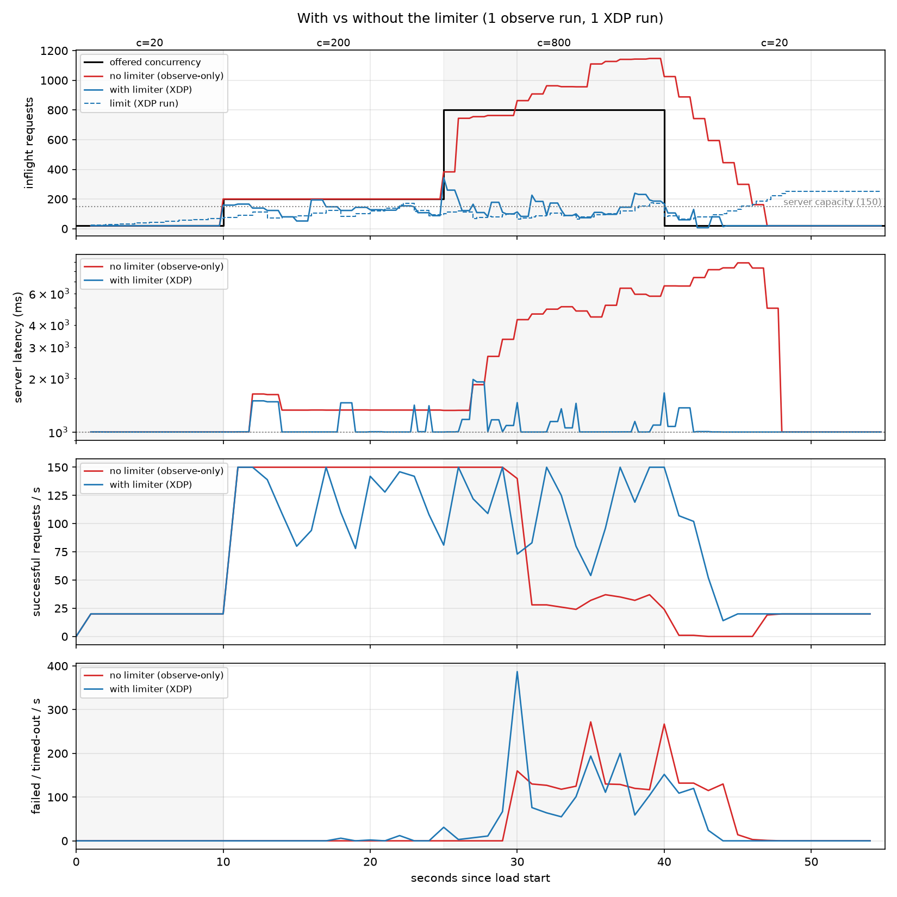

# Sloflo

Sloflo is a high-speed, adaptive concurrency gatekeeper for Linux that uses **XDP (eBPF)** to protect systems from overload at the network interface level. It ensures stability by keeping active requests (**Inflight**) within the server's real-time physical capacity.

## Overview

The core purpose of Sloflo is to maintain system stability by ensuring that the number of active requests (**Inflight**) does not exceed the system's current capacity. It achieves this through a closed-loop feedback mechanism that monitors latency to determine when the system is becoming congested.


## How it Works

Sloflo utilizes a gradient-based algorithm to dynamically calculate a safety ceiling for concurrent requests:

1.  **Application-Latency Signal:** The kernel measures, per request, the time from the request payload reaching the server socket to the server's first write back (`tcp_rcv_established` → `tcp_sendmsg`). Samples are averaged every tick (default 100ms).
2.  **Windowed Baseline:** **MinRTT** is the minimum latency seen in a sliding window (default 5s), so the baseline adapts to current conditions rather than being pinned to historic outliers.
3.  **Health Gradient:** A gradient is derived from the ratio of baseline latency to current latency ($\text{MinRTT} / \text{Latency}$). A dropping gradient signals that queues are forming and the system is slowing down.
4.  **Dynamic Scaling:** Each tick the limit becomes $L \cdot gradient + \sqrt{L}$, clamped to `[8, 250]`. Latency spikes shrink it multiplicatively; when healthy it grows by about $\sqrt{L}$ per tick.
5.  **NIC-Level Enforcement:** Inflight is the number of requests received but not yet answered. When it exceeds the limit, XDP drops new connection attempts (SYNs) for the target port, so excess load is rejected before it consumes kernel CPU or memory. Packets of established connections always pass so inflight can drain.

## Analysis & Performance
Against a test server with a fixed capacity of 150 concurrent requests (1s of work per request), load steps from 20 to 200 to 800 concurrent clients and back (single run per mode):

| c=800 | no limiter | with limiter |
|---|---|---|
| server latency p50 | 5007 ms | 1002 ms |
| inflight p50 (max) | 957 (1147) | 112 (344) |
| goodput | 78 req/s | 113 req/s |

Without the limiter the server queues over 1000 requests, latency climbs to 5–9s and successful responses collapse as clients time out. With it, inflight stays near the server's capacity and latency stays at baseline. Under steady light load (c=20) the limiter does not interfere. The limit is conservative: at c=200 it serves about 18% fewer requests than the unlimited server in exchange for steady latency.



## Testing

### Synthetic window-reset trace (no root, no eBPF)
```bash
go test ./internal/control -v -window-csv=plots/window_reset_trace.csv
python3 plots/plot_window_reset.py          # -> plots/window_reset_trace.png
```

### Live test on one machine (veth + netns client, needs root)
```bash
go generate ./cmd/rlimit

sudo tests/run_live.sh xdp neutral          # steady low load
sudo tests/run_live.sh xdp step             # 20 -> 200 -> 800 -> 20 concurrent clients
sudo tests/run_live.sh observe step         # same load, no dropping (baseline)
# args: <xdp|observe> <step|neutral> [time-scale] [run-label]

python3 plots/plot_live.py plots/live_step_xdp plots/live_step_observe   # one figure per run
```
Outputs land in `plots/live_<profile>_<mode>[_<label>].{trace,phases,requests}.csv` plus a `.log`. Repeat runs with labels and overlay them:
```bash
for r in 1 2 3; do
  sudo tests/run_live.sh observe step 1 r$r
  sudo tests/run_live.sh xdp step 1 r$r
done
python3 plots/compare_live.py --observe plots/live_step_observe_r{1,2,3} --xdp plots/live_step_xdp_r{1,2,3}
```
Plotting needs `matplotlib` and `pandas`. Controller flags: `-iface`, `-server-addr`, `-tick`, `-window`, `-observe-only`, `-csv`.

## License

This project is licensed under the Apache License 2.0 - see the [LICENSE](LICENSE) file for details.
