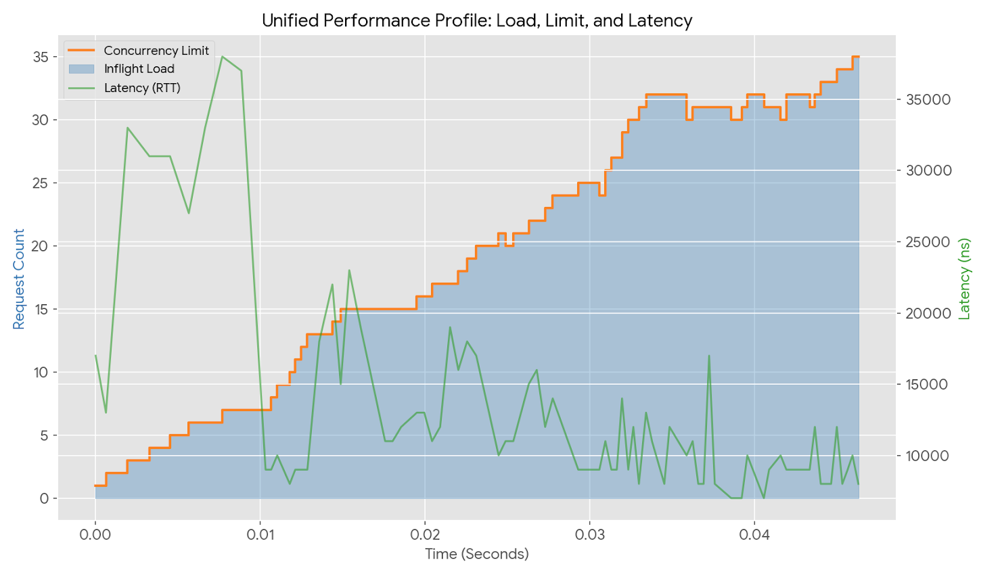

# Sloflo

Sloflo is a concurrency control engine for Linux that manages network traffic based on real-time service health. By operating at the XDP (eXpress Data Path) layer, it orchestrates traffic directly within the network interface driver, bypassing the overhead of the standard kernel networking stack.

## Overview

The core purpose of Sloflo is to maintain system stability by ensuring that the number of active requests (**Inflight**) does not exceed the system's current capacity. It achieves this through a closed-loop feedback mechanism that monitors latency to determine when the system is becoming congested.

## How it Works

Sloflo utilizes a gradient-based algorithm to dynamically calculate a safety ceiling for concurrent requests:

1.  **Latency Monitoring:** The tool tracks the Round-Trip Time (RTT) of requests, identifying the `MinRTT` (the baseline performance) and the `LatestRTT` (the current performance).
2.  **Gradient Calculation:** A health gradient is derived from the ratio of baseline latency to current latency ($\text{MinRTT} / \text{LatestRTT}$). A decreasing gradient indicates that the system is slowing down and queues are beginning to form.
3.  **Dynamic Limits:** Based on the gradient, Sloflo automatically scales the **Concurrency Limit** up to maximize throughput or down to shed load during latency spikes.
4.  **XDP Enforcement:** Decisions are enforced at the NIC level. If the number of inflight requests reaches the calculated limit, new incoming packets are immediately dropped using `XDP_DROP`.

## Analysis & Performance

The effectiveness of the concurrency control can be observed in the system metrics. As seen in the performance graphs, the **Inflight** requests strictly follow the **Concurrency Limit** baseline. 

When the system observes a decrease in latency (RTT), the algorithm increases the concurrency limit, allowing more inflight packets into the system. Conversely, as latency spikes, the gradient drops, and Sloflo immediately "clenches" the limit to protect the application from bufferbloat and resource exhaustion.

## Future Direction

Sloflo is moving toward **Service Level Objective (SLO)** integration. This will allow users to define specific latency targets (e.g., p95 < 50ms). The engine will then manage the concurrency limit specifically to stay within those business-defined bounds, balancing high hardware utilization with predictable performance.

## Analysis & Performance

The effectiveness of the concurrency control can be observed in the system metrics. As seen in the performance graph below, the **Inflight** requests strictly follow the **Concurrency Limit** baseline.

## License

MIT
