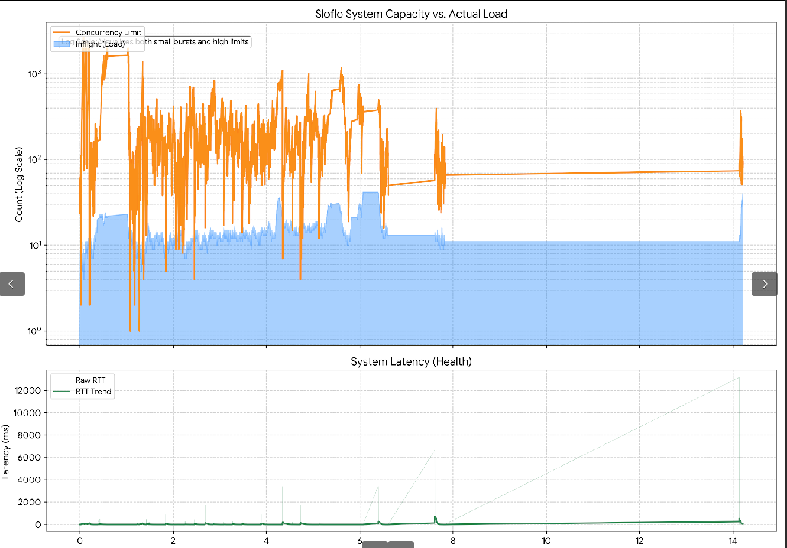

# Sloflo

Sloflo is a high-speed, adaptive concurrency gatekeeper for Linux that uses **XDP (eBPF)** to protect systems from overload at the network interface level. It ensures stability by keeping active requests (**Inflight**) within the server's real-time physical capacity.

## Overview

The core purpose of Sloflo is to maintain system stability by ensuring that the number of active requests (**Inflight**) does not exceed the system's current capacity. It achieves this through a closed-loop feedback mechanism that monitors latency to determine when the system is becoming congested.

## How it Works

Sloflo utilizes a gradient-based algorithm to dynamically calculate a safety ceiling for concurrent requests:

1.  **Sliding-Window Baseline:** The tool tracks Round-Trip Time (RTT) using a high-frequency sliding window (e.g., 10ms–1s). This allows the **MinRTT** (baseline) to drift, ensuring the tool adapts to current network conditions rather than being pinned to historic outliers.
2.  **Health Gradient:** A gradient is derived from the ratio of baseline latency to current latency ($\text{MinRTT} / \text{LatestRTT}$). A dropping gradient signals that queues are forming and the system is slowing down.
3.  **Dynamic Scaling:**
    * **The "Clench":** If latency spikes, the engine multiplicatively slashes the **Concurrency Limit** to shed load immediately.
    * **Probing Growth:** When healthy, it uses a square-root factor ($+\sqrt{L}$) to aggressively scale capacity—allowing the system to discover and support limits of thousands of concurrent requests.
4.  **NIC-Level Enforcement:** Decisions are enforced via `XDP_DROP`. Excess packets are rejected before they consume kernel CPU or memory.

## Analysis & Performance
In high-load environments, Sloflo demonstrates rapid convergence. Recent performance profiles show the tool scaling from a cold start to a concurrency limit of over **2,500 requests** in milliseconds while maintaining an extremely low overshoot rate (typically <2%). 

The **Inflight** requests strictly follow the **Concurrency Limit** ceiling. When the backend "Drain Rate" slows down, Sloflo instantly closes the gate, allowing the application to clear its backlog before reopening for more traffic.

## License

This project is licensed under the Apache License 2.0 - see the [LICENSE](LICENSE) file for details.
